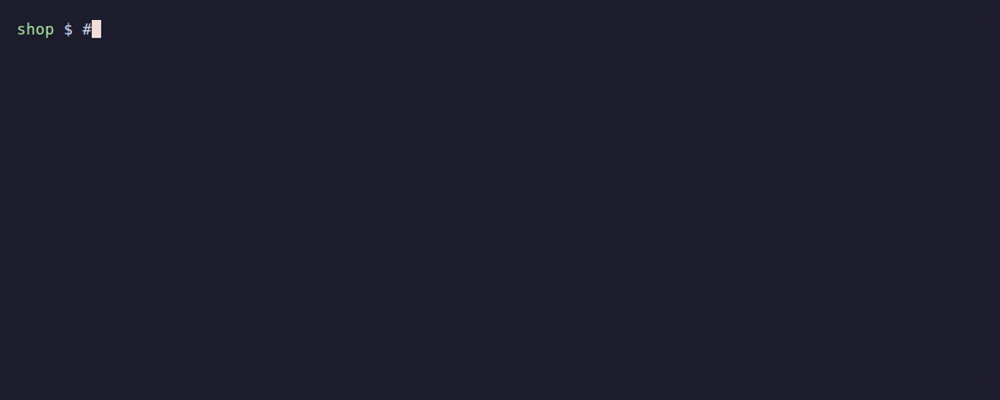

# heavyq

**Agents say done. heavyq knows.**

Your coding agent says the tests pass. Which commit did they pass on? heavyq keeps a ledger of every
heavy command it runs, keyed by the exact code it ran on, so "proven" is a lookup and not a claim. It is
also a priority, resource-aware queue that keeps six agents from running six test suites at once.

[](https://github.com/LysCongThanh/heavyq/actions/workflows/ci.yml)
[](https://github.com/LysCongThanh/heavyq/releases/latest)
[](https://pkg.go.dev/github.com/LysCongThanh/heavyq)
[](https://goreportcard.com/report/github.com/LysCongThanh/heavyq)
[](https://scorecard.dev/viewer/?uri=github.com/LysCongThanh/heavyq)
[](LICENSE)



```bash
curl -fsSL https://github.com/LysCongThanh/heavyq/releases/latest/download/install.sh | sh   # checks the sha256; or: go install github.com/LysCongThanh/heavyq@latest, see docs/install.md
heavyq hook install claude                         # Claude Code agents use the queue without being told
heavyq init --agents-md                            # write heavyq.toml, tell agents to run the gate first
```

Claude Code plugin: see [docs/claude-code.md](docs/claude-code.md).

## What it is

heavyq is a single static Go binary with no daemon: the queue is a directory and the proof is a JSONL
ledger on your machine. It is **local-first**. Nothing leaves the box unless you add an SSH remote
yourself. It works with **Claude Code today** (a `PreToolUse` hook, `heavyq hook install claude`) and with
any agent that can run a shell command; a Codex adapter is next. Linux first, macOS supported.

## Run, Prove, Steer

**Run.** Wrap a heavy command. Lower number goes first, light jobs jump ahead, and a job starts only if the
machine has RAM and CPU left. Identical runs on the same commit share one result.

```bash
heavyq 3 --lane api -- npm test          # waits its turn; exit 75 if --max-wait runs out
heavyq 4 --cache -- npm test             # same clean commit already tested? reuse that result
heavyq status                            # what runs, what waits, and why
```


**Prove.** A gate in `heavyq.toml` (or one detected from `go.mod`, `package.json`, `pytest`, `Cargo.toml`)
says what "done" means. `gate status` answers from the ledger in about 20 ms, for the exact tree checked
out now, uncommitted edits included; a gate that lists its `paths` is proven by those files only, so a docs-only
commit keeps the proof.

```bash
heavyq gate status    # PROVEN or NOT PROVEN on this tree; exit 0 or 1
heavyq gate run       # run what is not proven yet, through the queue, cached
```

**Steer.** When the caller is an agent, heavyq says little and ends with a digest the agent can act on.
Work items (`heavyq item ls|claim|release|done|block|sync`: claim, prove, finish) are in [docs/items.md](docs/items.md).
`heavyq brief` is the thread of the work in 300 tokens, injected after every compaction; `heavyq steer guard` adds a
Stop gate that will not let an agent stop while the item it holds is unproven ([docs/steer.md](docs/steer.md)).

```
heavyq: FAIL go test ./... · exit 1 · tree 3f2a9c1d7b0e · 12s
  --- FAIL: TestRun (0.01s)
  run_test.go:42: got 1, want 2
log: ~/.local/state/heavyq/logs/20261102T010203.123456Z-4242-wt-api.log (full output, 212 KiB)
next: fix the failure above, then re-run this command
```

## Dashboard


`heavyq dash` is read-only; `heavyq dash --control` lets the page cancel jobs, change priorities and pause
machines. It listens on loopback only. See [docs/dashboard.md](docs/dashboard.md). From a terminal,
`heavyq retarget <pid> --remote WHERE` moves a waiting job to other machines without cancelling it
([docs/remote.md](docs/remote.md#moving-a-waiting-ticket-heavyq-retarget)).

## Documentation

| Topic | Page |
|---|---|
| Install (script, `go install`, archives), verify signatures, completions, man page | [docs/install.md](docs/install.md) |
| The queue: priorities, slots, resource gate, quickstart | [docs/queue.md](docs/queue.md) |
| Gates, `heavyq.toml`, what "proven" means | [docs/gates.md](docs/gates.md) |
| Claude Code hook (zero config) and what it relies on | [docs/claude-code-hook.md](docs/claude-code-hook.md), [docs/claude-code.md](docs/claude-code.md) |
| Agent mode: terse output and the result digest | [docs/agent-mode.md](docs/agent-mode.md) |
| History as a ledger (commit, tree, session) | [docs/history.md](docs/history.md) |
| Receipts: a shareable, privacy-rounded summary (`heavyq receipts --share`) | [docs/receipts.md](docs/receipts.md) |
| Ledger tail reader, indexes, `heavyq doctor --reindex` | [docs/ledger.md](docs/ledger.md) |
| Cache and coalescing: never run the same gate twice | [docs/cache-and-coalescing.md](docs/cache-and-coalescing.md) |
| Spare machines over SSH, by exact commit, only where the run's tools resolve (`--tools`) | [docs/remote.md](docs/remote.md) |
| Pools: ports, databases, browsers handed out to parallel agents | [docs/pools.md](docs/pools.md) |
| Mentor: break repeat failures, measured with a holdout (`heavyq mentor`) | [docs/mentor.md](docs/mentor.md) |
| Dashboard, JSON snapshot, control API | [docs/dashboard.md](docs/dashboard.md) |
| `heavyq top`: a terminal monitor for a tmux pane, with display modes | [docs/top.md](docs/top.md) |
| `heavyq fleet`: observe every machine and every queue, other queues included (overload, waits, red runs split infra vs code, worker caps), as text, JSON, an atomic markdown report or an agent digest | [docs/fleet.md](docs/fleet.md) |
| `heavyq flow`: where work waits (needs-you, the constraint, throughput), derived from the ledger, leases and hooks | [docs/flow.md](docs/flow.md) |
| `heavyq statusline` (a segment for Claude Code's status line, with a forecast and local notices) and `heavyq recap` | [docs/statusline.md](docs/statusline.md), [docs/recap.md](docs/recap.md) |
| Configuration and environment variables | [docs/configuration.md](docs/configuration.md) |
| Editor support: JSON Schemas for `heavyq.toml`, the user config, `status --json` and `fleet --json` | [docs/configuration.md](docs/configuration.md#editor-support-json-schemas) |
| Exit codes | [docs/exit-codes.md](docs/exit-codes.md) |
| Work items: claim, prove and finish (`heavyq item`) | [docs/items.md](docs/items.md) |
| Steer: the brief after compaction, the stop gate (`heavyq steer off\|guard\|destroy`), the delivery canary | [docs/steer.md](docs/steer.md) |
| Preflight: GO or NO-GO before an unattended run, and the run span it opens (`heavyq preflight`, `heavyq run end\|ls\|current`) | [docs/preflight.md](docs/preflight.md) |
| Long runs: the 10-minute path from preflight to recap, for unattended Claude Code agent runs | [docs/long-runs.md](docs/long-runs.md) |
| Stances, leases, anchor | [docs/stances.md](docs/stances.md), [docs/leases.md](docs/leases.md), [docs/anchor.md](docs/anchor.md) |
| Comparison with pueue, task-spooler, `flock` | [docs/comparison.md](docs/comparison.md) |
| Platform support (Linux, macOS) | [docs/platform-support.md](docs/platform-support.md) |

The GIFs are recorded from real runs: `docs/tapes/proof.tape` (regenerated in CI on every release) and
`demo/demo.tape`.

## Contributing

See [CONTRIBUTING.md](CONTRIBUTING.md). Issues labelled
[good first issue](https://github.com/LysCongThanh/heavyq/labels/good%20first%20issue) are scoped to an
afternoon. Coding agents: start with [AGENTS.md](AGENTS.md). Security reports: [SECURITY.md](SECURITY.md).

## License

[MIT](LICENSE)
