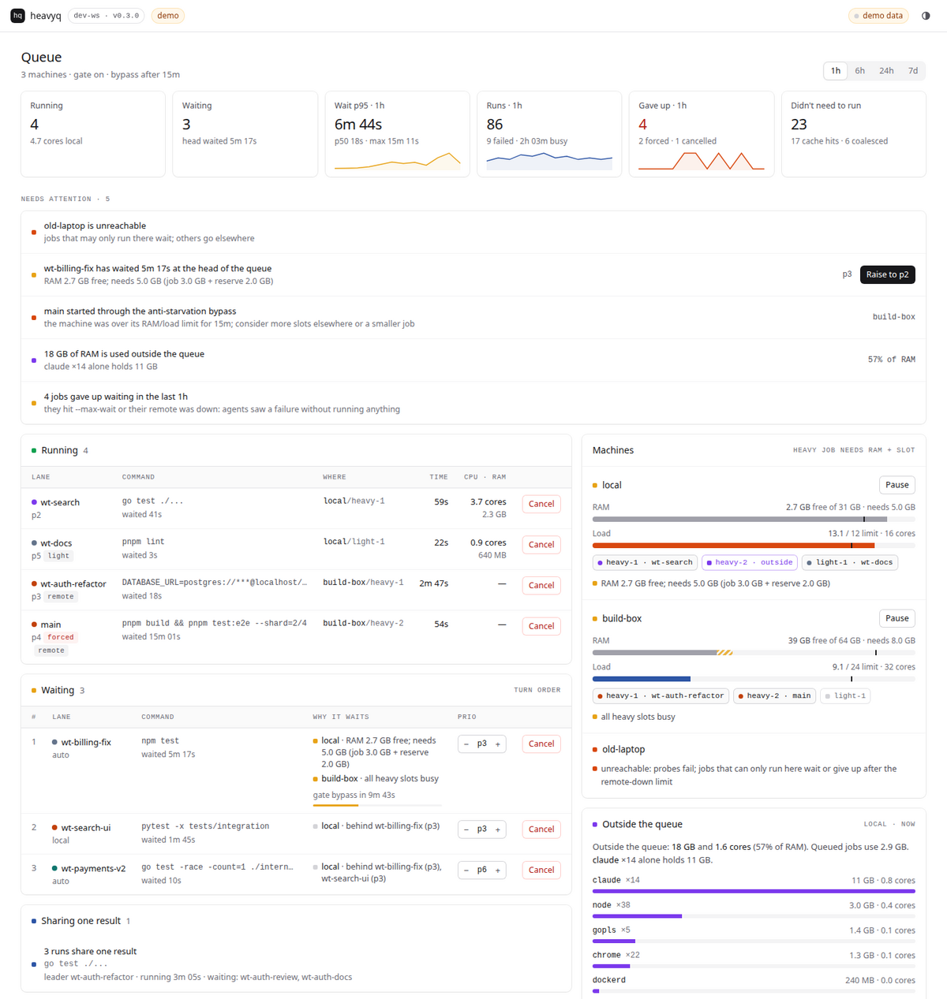

# heavyq

**A priority, resource-aware queue for heavy commands, built for workstations running many AI coding agents at once.**

> A lock that doesn't know priority is just a polite race.

[](https://github.com/LysCongThanh/heavyq/actions/workflows/ci.yml)
[](https://github.com/LysCongThanh/heavyq/releases/latest)
[](https://pkg.go.dev/github.com/LysCongThanh/heavyq)
[](https://goreportcard.com/report/github.com/LysCongThanh/heavyq)
[](https://scorecard.dev/viewer/?uri=github.com/LysCongThanh/heavyq)
[](LICENSE)


## The problem

You run six coding agents in six worktrees. Each one finishes a change and runs the gate: `npm test`,
`pnpm build`, `cargo test`, a Postgres-backed integration suite. Six test suites start in the same
second on one machine. Load goes to 60 on 16 cores, the OOM killer takes the slowest one, the rest time
out, and every agent retries. Nothing finishes.

The usual fix is `flock /tmp/build.lock npm test`. That serialises the work, but the kernel hands the lock
to whoever asks next. The hotfix waits behind the docs rebuild. Light jobs like lint wait behind heavy
ones. Nobody checks whether the machine has RAM left. And the spare laptop under your desk sits idle.

## What heavyq does

```bash
heavyq 3 --lane api -- npm test
```

- **Priority tickets.** Priority 1-9 (lower runs first), FIFO within a priority. A ticket is a file in a
  queue directory. If its process dies, the ticket is pruned (pid plus start time, so a reused pid
  doesn't keep it alive). Ctrl-C, SIGTERM and SIGHUP clean up. `--max-wait` gives up with exit 75.
- **Slots.** Each machine has N heavy slots and M light slots. `--light` jobs (lint, typecheck, unit tests)
  can use light slots, and jump ahead of waiting heavy jobs into them. Heavy jobs never use light slots,
  so they lose nothing. Slots are plain `flock(2)` files, so existing `flock <file> cmd` users still
  share them.
- **Resource gate.** A job starts only if available RAM covers its budget plus a reserve, and the 1-minute
  load is below `ratio x cores`. RAM for jobs that started in the last minute is held back (a new job
  hasn't grown yet). An idle machine always takes a job. A head ticket that has waited past
  `force_after` bypasses the gate, so nothing starves.
- **`heavyq status`.** Shows running and waiting tickets in order, per-machine resources, who holds each
  slot, why the head ticket waits, and *who holds the load*: CPU% per lane. It gets this by walking each
  process's ancestry in `/proc` to a ticket, and lists everything else as "outside the queue".
- **Spare machines over SSH, by exact commit.** heavyq can run a job on another box. It pushes the exact
  commit (`--ref`, default `HEAD`) to a bare repo there, creates a temporary worktree, runs the command,
  streams the logs back, returns the exit code and cleans up. With no `--remote` flag, a ticket is placed
  by score (`free RAM - k x load`) only when the repo is clean and the command references nothing
  outside the repo. Otherwise it stays local.
- **Agents don't need to know.** A Claude Code `PreToolUse` hook rewrites `npm test`, `go test ./...` and
  friends into a queued heavyq run before they execute. `heavyq hook install claude` sets it up.
- **The same gate runs once per commit.** With `--cache`, identical commands on the same clean tree share
  one run: whoever comes second waits for the first and gets its output and exit code. Finished results are
  replayed until they expire.
- **History.** Every run is appended to a JSONL log (wait time, run time, machine, exit code, cache
  hit/miss/coalesced). `heavyq history` prints it.

Single static Go binary. No daemon. The queue is a directory.

## Install

```bash
go install github.com/LysCongThanh/heavyq@latest
```

Or download a binary from [Releases](https://github.com/LysCongThanh/heavyq/releases) (Linux and macOS, amd64 and arm64).
Each release ships SHA-256 checksums, an SPDX SBOM per archive, and GitHub build provenance:
`gh attestation verify <archive> --repo LysCongThanh/heavyq`.

## Quickstart

```bash
# Wrap heavy commands. Lower priority number = earlier turn.
heavyq 3 --lane api -- npm test
heavyq 2 --lane checkout -- pnpm build            # jumps ahead of priority 3+
heavyq 6 --light --lane docs -- npm run lint      # may take a light slot right away
heavyq 4 --max-wait 10m -- cargo test             # exit 75 if not started within 10 minutes

heavyq 4 --cache -- npm test                      # same clean commit already tested? reuse that result

heavyq status      # what runs, what waits, and why (opens with a short story in plain words)
heavyq why         # just that story: "2 agents wait because every heavy slot on local is taken."
heavyq why api     # one lane: its running and waiting jobs, the reason per machine, its last run
heavyq history     # recent runs
heavyq hook install claude   # let Claude Code agents use the queue without being told
```

With no config file you get 2 heavy slots, 1 light slot, the resource gate on, and local runs only.

## Zero-config for agents (Claude Code hook)

Parallel agents are the reason this tool exists. You shouldn't have to teach each one a wrapper.

```bash
heavyq hook install claude                    # this project, just you: .claude/settings.local.json
heavyq hook install claude --scope project    # this project, committed: .claude/settings.json
heavyq hook install claude --scope user       # every project: ~/.claude/settings.json
heavyq hook install claude --print            # show the merged settings, write nothing
heavyq hook uninstall claude
```

The installer adds one `PreToolUse` hook with matcher `Bash`. It keeps everything else in the file, writes a
`.bak` first, and running it again changes nothing. From then on, when an agent runs `go test ./...`,
Claude Code passes the call to `heavyq hook claude-pretooluse`, which returns an `updatedInput`:

```
go test ./... 2>&1 | tail -30
  ->  heavyq 4 --lane wt-api --max-wait 300s -- go test ./... 2>&1 | tail -30
```

- **What gets wrapped.** By default: `npm`/`pnpm`/`yarn` `test`, `run test`, `run build` and `run gate`;
  `run typecheck` and `run lint` as `--light`; `go test`, `go build ./...`, `pytest` (also `python -m pytest`),
  `cargo test` and `cargo build`, `make test` and `make check`, `gradle`/`./gradlew test`, `mvn`/`./mvnw test`.
  Rules match whole words from the start of the command, so `npm run test:e2e` and `echo go test` don't
  match. Add your own with `[[hook.rule]]`. Each rule sets a priority, light vs heavy, a fixed lane and
  `cache = true`.
- **Lane.** The rule's `lane`, else `$HEAVYQ_LANE`, else the name of the git work tree containing the
  agent's cwd. One worktree per agent gives one lane per agent.
- **Shapes it understands.** `[cd DIR &&] [VAR=x ...] CMD ARGS [2>&1] [| tail|head|grep ...]`. Commands with
  `VAR=x` assignments are pinned with `--remote local`, because environment variables don't travel to
  remotes. Everything else is left exactly as typed: `;`, `||`, other `&&` chains, a background `&`,
  `$(...)`, backticks, redirections, several pipes, commands already wrapped, and any call made while
  `HEAVYQ_ACTIVE` is set (heavyq sets it for the commands it runs).
- **Timeouts.** The hook adds `--max-wait` (`hook.max_wait`, default 5m) and raises the Bash tool's
  `timeout` by the same amount, so queue time doesn't use up the tool timeout. Exit 75 still means "busy,
  retry later". The agent is told so through `additionalContext`.
- **It fails open.** Bad input, a broken config, a panic: the hook prints nothing and exits 0, so Claude
  Code runs the original command. The problem goes to `~/.local/state/heavyq/hook.log`. A bug in heavyq
  must never block an agent.

**Honest limits** (details and doc quotes in [docs/claude-code.md](docs/claude-code.md)):

- Permissions are evaluated against the *rewritten* command. By default heavyq approves nothing, so
  `Bash(npm test:*)` doesn't cover `heavyq 4 --lane api --max-wait 300s -- npm test`. Approve it at the
  prompt, allow that exact prefix, or set `hook.permission = "allow"`. That setting auto-approves only the
  commands your rules matched. Don't allow `Bash(heavyq:*)`.
- If another `PreToolUse` hook also rewrites Bash commands, Claude Code's docs don't say whose rewrite
  wins. Don't combine them.
- Only Claude Code for now. Adapters for other agents are open issues.
- The hook was verified with Claude Code 2.1.316 (`claude -p`: the agent ran `go test ./...`, heavyq queued
  it, and the second call was a cache hit).

**Without the hook**, you can still put a rule in `CLAUDE.md` ("run heavy commands as
`heavyq <prio> --lane <worktree> --max-wait 9m -- <command>`"), or block unwrapped commands with
[`examples/claude-code/require-heavyq.sh`](examples/claude-code/require-heavyq.sh), which makes the agent
rerun them itself.

## Never run the same gate twice (cache + coalescing)


```bash
heavyq 4 --cache -- npm test
```

- **Key.** sha256 of the HEAD tree, the exact argv, the cwd relative to the repo root, the values of the
  variables listed in `cache.env`, the `--base-ref` commit (if any) and the heavyq version. A new commit
  with the same tree (an empty commit, a rebase that changes nothing) still hits.
- **Only clean trees.** If anything tracked is modified, or any untracked file isn't ignored, the run
  goes ahead normally and nothing is cached. `-v` says why, and history records `skip` with the
  reason. The tree is checked again after the run. If it changed meanwhile, the result is not stored.
- **Coalescing.** If an identical key is running right now, the second caller doesn't queue a duplicate
  ticket. It waits for that run and replays its output and exit code. `status` shows
  `3 waiting on lane api's run`. This works for failures too: the callers that waited get the same
  failure. If the first run is killed or never starts, one of the waiting callers runs the command
  itself.
- **Hits.** Output is replayed to stdout and stderr in the order it was captured, then the exit code is
  returned, followed by `heavyq: cached result from 2026-11-01 20:51:18 (local)` on stderr. Successes are
  cached. Failures are cached only with `cache_failures = true`.
- **Storage.** `~/.cache/heavyq/results` (`$XDG_CACHE_HOME`), one output file plus metadata per key,
  written atomically under a `flock`. Expired entries (`ttl`, default 24h) are dropped, then the oldest go
  until the total fits `max_size_mb` (512). `heavyq cache ls`, `heavyq cache stats` (with hit, coalesced and
  miss counts from history) and `heavyq cache clear` manage it.

**Honest limits:**

- The key sees committed content only. Ignored files (`.env.test`, `node_modules`, a local database), the
  toolchain version, the OS and the network are invisible to it. If they change the result, list the
  relevant variables in `cache.env`, or don't use `--cache` for that command.
- A command that writes untracked, non-ignored files into the repo (coverage reports, build output) makes
  the tree dirty, so its result is never stored. Ignore those paths in `.gitignore`.
- With `--cache`, the command's stdout and stderr are pipes, not your terminal, so tools may turn colours
  off. The order of output between stdout and stderr is kept as heavyq received it, not more precisely.
- Results are per machine and per user. Entries aren't shared between machines.
- Not with `--ref` other than HEAD or with `--with` (skipped, with the reason).

## Spare machines

Add a remote in `~/.config/heavyq/config.toml`:

```toml
[[remote]]
name = "buildbox"     # used in --remote buildbox and in status
ssh = "buildbox"      # an alias from ~/.ssh/config (key auth; ControlMaster recommended)
heavy_slots = 2
light_slots = 2
cache_hook = '''
# optional: restore node_modules from a cache keyed by the lockfile
[ -f package-lock.json ] || exit 0
key=$(sha256sum package-lock.json | cut -c1-16); c="$HEAVYQ_CACHE_DIR/nm-$key"
if [ -d "$c" ]; then cp -al "$c" node_modules; exit; fi
npm ci --no-audit --no-fund && { cp -al node_modules "$c.$$" && mv -T "$c.$$" "$c" || rm -rf "$c.$$"; } 2>/dev/null; true
'''
```

Then:

```bash
heavyq 3 --remote buildbox -- npm test        # always there
heavyq 3 --remote auto -- npm test            # best score; you vouch the command is self-contained
heavyq 3 -- npm test                          # best score only if the repo is clean and paths stay inside it
heavyq 3 --remote local -- npm test           # never leave this machine
heavyq 3 --needs-ram -- npm run e2e           # place by free RAM only
heavyq 3 --remote buildbox --base-ref origin/main -- npm run lint:changed   # recreate origin/main there
heavyq 3 --remote buildbox --with ../shared-lib@v2.1.0 -- npm test          # sibling repo pinned to a commit
```

What a remote run sees, and what it doesn't:

- **Only committed code.** The exact SHA of `--ref` is pushed with `git push` (it doesn't need to be on
  GitHub). Uncommitted edits and ignored files (`.env.test`, `dist/`) stay behind.
- **Environment variables don't travel.** `FOO=1 heavyq ... -- npm test` sets `FOO` only locally. Put them
  inside the command: `heavyq 3 -- env FOO=1 npm test`.
- **The same subdirectory.** If you run from `repo/packages/web`, the command runs in `packages/web` of the
  remote worktree.
- **Clean teardown.** The remote side holds a lifeline on stdin. If heavyq dies, even by SIGKILL, or the
  connection drops, the remote stops the command's process group and removes the worktree. Exit 255 means
  the connection was lost.

Remote requirements: Linux with `bash`, `git`, `flock`, `setsid` (util-linux), `base64`, `awk`. Nothing is
installed. Everything lives under `work_dir` (default `~/.heavyq`).

## Dashboard and control



```bash
heavyq dash              # read-only; prints http://127.0.0.1:PORT/#token=...
heavyq dash --control    # the page can also cancel jobs, change priorities, pause machines
heavyq status --json     # the same state, machine-readable (schema 1, with the story as sentences)
```

The dashboard answers, in this order: is the machine OK, what runs and what it costs, **who waits and
why** (a reason per waiting job and per machine, plus the anti-starvation countdown), what eats the
machine *outside* the queue (by executable: often the agents themselves), and how the last hour went
(wait p50/p95, give-ups, forced admissions, cache hits, busiest lanes).

There is no daemon. `heavyq dash` reads the same queue files as `heavyq status`, and actions are requests
that the job's own heavyq process applies on its next poll. The same actions work from a terminal:

```bash
heavyq cancel 48213        # by the pid shown in status: a waiting job leaves the queue, a running one is stopped
heavyq reprio 50122 2      # a waiting job moves to priority 2 (keeps its place among equals)
heavyq pause buildbox      # no new jobs start there; running jobs finish
heavyq resume buildbox
```

Open `http://127.0.0.1:PORT/#demo` from any `heavyq dash` to see the page with sample data.

The server listens on loopback only, requires the per-start token on every API call, rejects foreign
`Host` and `Origin` headers, and hides likely secrets in command lines. See [docs/dashboard.md](docs/dashboard.md)
for the API.

## Gates (heavyq.toml)

A repository can say what "proven" means for it in a `heavyq.toml` at its repository root: named **gates**,
each a list of shell commands.

```toml
[[gate]]
name = "ready"
run  = ["gofmt -l . | (! grep .)", "go vet ./...", "go test -race ./..."]
prio = 3          # 1-9, default 3
# light  = true   # may use the light slots
# remote = "auto" # local (default) | auto | <remote name>
```

- `name`: `[a-z0-9][a-z0-9_-]{0,39}`, unique in the file. `run`: a non-empty list of shell strings, each at
  most 2000 bytes.
- Unknown keys, duplicate names, an empty `run` or a `prio` outside 1-9 are errors that name the file and,
  for unknown keys, the line. heavyq never guesses.
- **Trust: the same as a Makefile.** `heavyq.toml` holds commands, and whoever can edit it can make them run.
  Gates run only when you ask for them explicitly. Hooks never execute gates, and the Claude Code hook does
  not read the file.
- Status: the loader and the format are in place (see [docs/gates.md](docs/gates.md)). The commands that run
  and check gates (`heavyq gate run`, `heavyq gate status`) follow in the next release.

## Comparison

| | heavyq | [pueue](https://github.com/Nukesor/pueue) | [task-spooler](https://viric.name/soft/ts/) | GNU parallel / `sem` | plain `flock` |
|---|---|---|---|---|---|
| Model | wrapper, no daemon; queue is a directory | daemon + client | per-user server | job runner; `sem` = counting semaphore | kernel lock |
| Priority | 1-9, FIFO within | yes (`--priority`, since 3.2) | urgent flag (`-u`) | no | no |
| Caller blocks until done, gets exit code | yes | no (`pueue wait` / `follow`) | optional (`-c`, `-w`) | yes | yes |
| Concurrency limits | heavy + light slots per machine | per-group parallelism | slots (`-S`) | `-j` / `sem -j` | 1 |
| RAM / load gate | yes, with reservation + anti-starvation | no | no | `--memfree`, `--load` (own jobs) | no |
| Light jobs jump ahead | yes, into light slots | no | no | no | no |
| CPU attribution per lane | yes (`status`) | no | no | no | no |
| Remote execution | by exact commit, temp worktree, auto placement | no (remote *clients*) | no | `--sshlogin` (copies files, no git) | no |
| Pause / resume / edit queued tasks | no | yes | partly | no | no |
| Persistent logs of each task | no (streams to caller) + history | yes | yes | `--results` | no |
| Agents use it without being told | yes (Claude Code hook rewrites heavy commands) | no | no | no | no |
| Identical runs share one result | yes (`--cache`: by git tree, in flight and cached) | no | no | no | no |

Pick **pueue** if you want a long-lived personal task manager with pause, edit and logs. It is excellent,
and heavyq owes the "queue for your shell" idea to it and to task-spooler. Pick **heavyq** when many
independent callers (agents, scripts, CI shells) each need to run something heavy, wait for their turn
in priority order without overloading the machine, and get the exit code back.

## Configuration

`--config FILE`, else `$HEAVYQ_CONFIG`, else `$XDG_CONFIG_HOME/heavyq/config.toml` (`~/.config/heavyq/config.toml`).
Every key is optional. [`examples/config.toml`](examples/config.toml) has every key with comments.

| Key | Default | Meaning |
|---|---|---|
| `queue.poll` | `"2s"` | how often a waiting ticket retries |
| `queue.force_after` | `"15m"` | head ticket waiting this long bypasses the RAM/load gate |
| `queue.resource_gate` | `true` | `false` = slots only |
| `queue.auto` | `true` | score-based placement for tickets without `--remote` |
| `queue.load_weight_mb` | `500` | `k` in `score = free_mb - k x load1` |
| `queue.hold_for` | `"1m"` | how long a fresh job's RAM budget stays reserved |
| `queue.remote_down_max` | `"10m"` | remote-only ticket exits 76 after its remotes are unreachable this long |
| `queue.probe_timeout` | `"5s"` | timeout of one remote metrics probe |
| `queue.base_ref` | `""` | default `--base-ref` |
| `local.heavy_slots` / `light_slots` | `2` / `1` | slots on this machine |
| `local.legacy_lock_files` | `[]` | use these files as heavy slots (shared with `flock <file>` users) |
| `*.max_load_ratio` | `0.75` | admit while `load1 < ratio x cores` |
| `*.job_mb` / `light_mb` / `reserve_mb` | `3072` / `1024` / `2048` | RAM budget per heavy / light job, and headroom |
| `remote.name`, `remote.ssh` | required | name and ssh alias (`ssh` may be replaced by `transport` + `git_url`) |
| `remote.transport` | `["ssh","-o","BatchMode=yes","-o","ConnectTimeout=10",ssh]` | argv prefix; the remote script is appended as one argument |
| `remote.work_dir` | `".heavyq"` | remote directory (relative to the remote home) |
| `remote.git_url` | `"<ssh>:<work_dir>/git"` | where bare repos are pushed |
| `remote.cache_hook` | `""` | shell run in the worktree before the command; gets `HEAVYQ_CACHE_DIR`, `HEAVYQ_WORKTREE` |
| `hook.enabled` | `true` | `false` = the Claude Code hook never rewrites |
| `hook.permission` | `""` | `""` = rewritten commands go through Claude Code's permission flow; `"allow"` = approve them |
| `hook.max_wait` | `"5m"` | `--max-wait` added to rewritten commands (and to the Bash tool timeout) |
| `hook.binary` | `""` | how rewritten commands call heavyq (default `heavyq` if on PATH, else the absolute path) |
| `hook.default_rules` | `true` | apply the built-in rules after yours |
| `hook.rule.match` | required | word prefixes, e.g. `["bun test", "deno task check"]` |
| `hook.rule.priority` / `light` / `lane` / `cache` | `4` / `false` / `""` / `false` | what the rewritten command gets |
| `cache.ttl` | `"24h"` | cached results older than this are ignored and evicted |
| `cache.max_size_mb` / `max_entry_mb` | `512` / `64` | total cap (oldest evicted first) / larger outputs are not stored |
| `cache.cache_failures` | `false` | also replay non-zero exits to later runs (runs that waited always share) |
| `cache.env` | `[]` | variable names whose values are part of the key, e.g. `["CI", "NODE_ENV"]` |

Environment: `HEAVYQ_LANE` (default lane), `HEAVYQ_REMOTE` (default `--remote`), `HEAVYQ_AUTO=0` (never
auto-place), `HEAVYQ_DIR` (queue dir; default `$XDG_RUNTIME_DIR/heavyq`, else `/tmp/heavyq-<uid>`),
`HEAVYQ_HISTORY` (default `$XDG_STATE_HOME/heavyq/history.jsonl`), `HEAVYQ_CONFIG`, `XDG_CACHE_HOME` (result
cache), `CLAUDE_CONFIG_DIR` (`--scope user` target). Commands run locally get `HEAVYQ_MACHINE`, `HEAVYQ_SLOT`,
`HEAVYQ_LANE` and `HEAVYQ_ACTIVE=1` (the hook never rewrites while it is set).

## Exit codes

| Code | Meaning |
|---|---|
| *command's own* | the command ran; this is its exit code (128+n if killed by signal n) |
| 2 | usage or setup error (nothing ran) |
| 75 | `--max-wait` elapsed before the ticket's turn (EX_TEMPFAIL: retry later) |
| 76 | the ticket can only run remotely and its remotes were unreachable for `remote_down_max` |
| 77 | remote preparation failed (push, worktree, cache hook, or a slot taken outside the queue) |
| 78 | cancelled by an operator (`heavyq cancel` or the dashboard) |
| 127 / 126 | command not found / not executable |
| 255 | connection to the remote lost mid-run (the remote side stops the command) |

## Platform support

Linux is the primary target and is what CI runs. On **macOS**, slots, priorities, tickets and remote runs
work. Local RAM and load are not measured (there is no `/proc`), so the local gate falls back to slots
only and `status` says so. Per-lane CPU attribution, the "outside the queue" breakdown and cancelling a command's
whole process tree are Linux-only (elsewhere a cancel reaches the command and the children visible at that moment). Process identity uses `ps -o lstart=`.
Remote machines must be Linux.

## Contributing

See [CONTRIBUTING.md](CONTRIBUTING.md). Issues labelled
[good first issue](https://github.com/LysCongThanh/heavyq/labels/good%20first%20issue) are scoped to an
afternoon. Coding agents: start with [AGENTS.md](AGENTS.md). Security reports: [SECURITY.md](SECURITY.md).

## License

[MIT](LICENSE)
