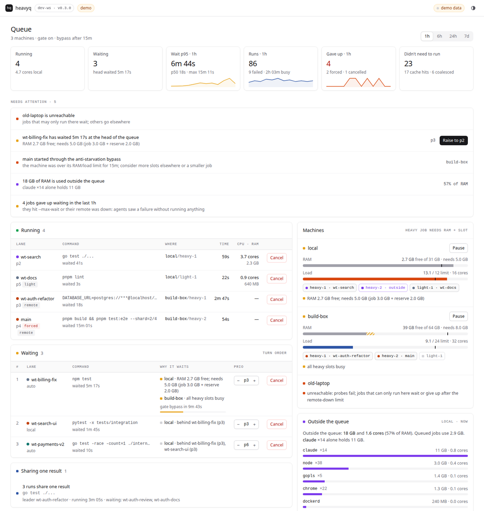

# Dashboard, JSON snapshot and control API

`heavyq dash [--control] [--addr 127.0.0.1:0] [--interval 2s] [--open]` serves one embedded page and the
API below. It prints a link of the form `http://127.0.0.1:PORT/#token=TOKEN`. The token is generated at
every start, lives only in the URL fragment (never sent in requests as a URL), and must be sent as
`Authorization: Bearer TOKEN` on every API call.



```bash
heavyq dash              # read-only; prints http://127.0.0.1:PORT/#token=...
heavyq dash --control    # the page can also cancel jobs, change priorities, pause machines
heavyq status --json     # the same state, machine-readable (schema 1, with the story as sentences)
```

The dashboard answers, in this order: is the machine OK, what runs and what it costs, **who waits and
why** (a reason per waiting job and per machine, plus the anti-starvation countdown), what eats the
machine *outside* the queue (by executable: often the agents themselves), and how the last hour went
(wait p50/p95, give-ups, forced admissions, cache hits, busiest lanes).

There is no daemon. `heavyq dash` reads the same queue files as `heavyq status`, and actions are requests
that the job's own heavyq process applies on its next poll. The same actions work from a terminal:

```bash
heavyq cancel 48213        # by the pid shown in status: a waiting job leaves the queue, a running one is stopped
heavyq reprio 50122 2      # a waiting job moves to priority 2 (keeps its place among equals)
heavyq retarget 50122 --remote spare   # a waiting job moves to other machines (keeps its place; docs/remote.md)
heavyq pause buildbox      # no new jobs start there; running jobs finish
heavyq resume buildbox
```

Open `http://127.0.0.1:PORT/#demo` from any `heavyq dash` to see the page with sample data.

## Security model

- Listens on loopback only (`127.0.0.1`, `::1`, `localhost`); other addresses are refused. `localhost` always
  means `127.0.0.1` (it is never looked up, so a hosts file or DNS cannot move it), and a listener that is not
  bound to a loopback address is closed and refused.
- Requests whose `Host` header is not the loopback address and port are refused (DNS rebinding). On port 80,
  where browsers leave the port out, the bare `127.0.0.1`, `localhost` and `[::1]` are accepted too.
- Requests carrying an `Origin` other than the dashboard's own are refused (cross-site requests).
- The page is served with `default-src 'none'` and `connect-src 'self'`: it loads nothing from the network.
- Read-only by default. State-changing endpoints answer 403 unless the server runs with `--control`.
- Command lines are passed through a redactor before they are served (also in `status --json`).
- A refused request is answered at once and its connection closed (a body announced and never sent is not
  waited for), and an idle keep-alive connection is closed after a minute, so a local user without the token
  cannot pin sockets.
- `--open` hands the browser a 0600 redirect page in the queue directory, never the token on a command line. A
  confined browser (the Firefox snap) cannot read that directory and shows an error: open the printed link
  instead.

Anyone who can run processes as your user can already do everything the dashboard does, so the goal is to
keep other users, other machines and web pages out, not to separate privileges within your account.

## Endpoints (`/api/v1/`)

| Method & path | Answer |
|---|---|
| `GET meta` | `{"version","host","schema":1,"control":bool,"interval_ms"}` |
| `GET snapshot` | the current snapshot (same as `heavyq status --json`) |
| `GET stream` | Server-Sent Events: `event: snapshot` with the snapshot every `interval_ms`; `: keep-alive` comments every 15 s. One producer serves every open stream. |
| `GET history?n=100` | `{"records":[...]}`, newest last, at most 1000 |
| `GET insights?window=1h` | summary of history over `1h`, `6h`, `24h` or `7d`, in 12 buckets |
| `GET receipts?window=week` | the receipts of `day`, `week` (default) or `month`: exact counts and the rounded share card (see [receipts.md](receipts.md)) |
| `POST tickets/{id}/cancel` | 202. Waiting: leaves the queue. Running: SIGTERM to the process tree, SIGKILL after 10 s. Exit 78. |
| `POST tickets/{id}/prio` `{"prio":1-9}` | 202 for waiting tickets, 409 for running ones |
| `POST tickets/{id}/target` `{"remote":"WHERE"}` | 202 for a waiting ticket the move is safe for: it waits for the machines of `WHERE` from its next poll; right after a config edit the request is filed once the ticket follows the edit, within two polls (`heavyq retarget`, see [remote.md](remote.md#moving-a-waiting-ticket-heavyq-retarget)). 400 with the reason for a move `heavyq retarget` refuses, 409 for running tickets. Not on the page yet. |
| `POST machines/{name}/pause`, `.../resume` | 200. Paused machines admit nothing new. |

Errors are `{"error":"..."}` with 400, 401, 403, 404, 409 or 421 (wrong `Host`).

## The Tower: what needs you

The top of the page is empty unless something needs a human: one calm line (`Nothing needs you. 4 lanes
working, 2 unproven.`), with the story and the flow below it. Otherwise it shows one card per exception: a
severity dot, one sentence, the evidence (when, lane or machine, tree, command, count) and at most one
action. With `--control` the action is a button (cancel a job, raise a priority, resume a machine); without
it, or for `run` actions, the card shows the command to copy. Every card has a dismiss button: the
exception stays hidden in that browser for 10 minutes (`localStorage`, key `hq.snooze`), and comes back
earlier if it gets worse (a loop with one more failure is a new exception). Unproven lanes are a count, not
a card.

Exceptions are facts heavyq measured, never what an agent claims. They are computed in Go
(`internal/snapshot`) from the snapshot, the run ledger and each recently active lane's work tree, so
`heavyq status --json` (`exceptions[]`), `heavyq why` (one `Needs you:` line each) and the page agree.

| `kind` | When | Severity | Action |
|---|---|---|---|
| `red_gate` | the latest conclusive run of a gate command on the lane's current tree failed (`heavyq gate status` says the same), and it is not classed `flaky` or `under_load` | critical | `run`: `cd <worktree> && heavyq gate run <gate>` |
| `loop` | the same command failed at least 2 times on the same tree in a lane within 30 minutes | critical | `cancel` the lane's job, if it has one |
| `starved` | the head of the queue waited more than 2/3 of `force_after` and nothing would take it, or a lane gave up in the last hour | warning | `raise` the head's priority by one |
| `blocked` | a lane recorded `heavyq item block <id> "needs: ..."` and nobody claimed the item since | critical | `run`: `heavyq item claim <id>`, once the need is met |
| `machine` | a machine is unreachable or paused, or processes outside the queue hold more than 40% of the local RAM | warning | `resume` for a paused machine |

Each exception is `{id, kind, severity, lane?, machine?, text, evidence{at, tree, cmd, count, gate,
item, detail}, action{kind, target, value, command}?}`. `text` is one sentence; `evidence` fields that do not
apply are absent; `action.command` is always the command to type.

`gates[]` is what the red-gate check read: per lane that ran in the last hour, the main gate's `state`
(`proven`, `unproven`, `failed`, or `skipped` with a `reason`: no `heavyq.toml`, no gate named `ready` among
several, an unidentifiable tree, or the budget below ran out). Proofs are computed for at
most 8 work trees per snapshot, within 1.5 s, and reused for 10 s.

## Snapshot (schema 1)

The Go definition is the reference: [`internal/snapshot/snapshot_types.go`](../internal/snapshot/snapshot_types.go).
Its JSON Schema, generated from that file, is [`schema/status.schema.json`](../schema/status.schema.json)
([editor and client use](configuration.md#editor-support-json-schemas)).
Fields may be added within schema 1; renaming or removing one bumps `schema`.

- `machines[]`: `free_mb`, `total_mb`, `reserved_mb` (RAM promised to jobs that started less than
  `hold_for` ago), `load1`, `max_load`, the job budgets, `slots[]` (`free`, `held` by a ticket, or `outside`:
  locked by something that isn't in the queue), `paused`, and `admits` (`""` when a heavy job could start now,
  otherwise the reason).
- `running[]`: lane, priority, command, machine/slot, `wait_s`, `run_s`, `forced` (admitted by the
  anti-starvation bypass), and `cpu_pct` / `rss_mb` of the whole process tree for local jobs.
- `waiting[]`: in turn order, with `reasons` per candidate machine (`""` = starts on its next poll;
  `"decides under another config than this one"` when this config has room but the ticket's own heavyq reads
  another file, or an edit it has not polled yet, see [configuration](configuration.md#editing-the-config-while-tickets-wait);
  `"not in this config"` for a candidate remote this config does not have, such as one removed while it waits) and
  `bypass_in_s` (head of line only, `-1` otherwise, and `-1` when the bypass would not help: several candidate
  machines, or the ticket waits for RAM or a pool).
- `coalesced[]`: identical `--cache` runs waiting for one leader.
- `cpu`: local CPU and memory per lane, and outside the queue per executable (top 8 plus a total).
- `story[]`: the state of the queue as sentences, built in Go so the dashboard, `heavyq status` and
  `heavyq why` say the same thing. Each sentence is `{"text": "...", "parts": [{"text", "em", "num", "lane",
  "hot"}]}`: `text` is plain, `parts` add emphasis (`em`; `num` for a figure; `lane` for a lane name; `hot`
  for a problem). `em`, `num`, `lane` and `hot` are omitted when false or empty, and the `text` of all parts
  joined is the sentence's `text`. Countdowns ("skips the load check in 2m 10s") are as of
  `generated_at`. The page renders `story` when present and falls back to its own copy of the logic for older
  servers.
- `gates[]` and `exceptions[]`: the Tower, described above.
- `items[]`: per lane, the work items it holds or waits on (`heavyq item`, see [items.md](items.md)):
  `{lane, repo, items:[{id, state: claimed|proven|blocked, commit?, needs?, at?}]}`.

## Control without the dashboard

Requests are files in `<queue dir>/ctl/`: `<ticket>.cancel`, `<ticket>.prio`, `<ticket>.target`, `pause-<machine>`.
They are what `heavyq cancel|reprio|retarget|pause|resume` and the dashboard write, and what each job's heavyq process
reads about once per poll interval. Scripts may write them directly; write a uniquely named temporary file in the same
directory and rename it into place, so two writers never share a half-written file. `<ticket>` is the `id` field of the
snapshot without its leading `<prio>-`, so a request still reaches a ticket whose priority changed. A job answers a
`.target` request in `<ticket>.target-done`: empty when it moved, else why it kept its machines.
